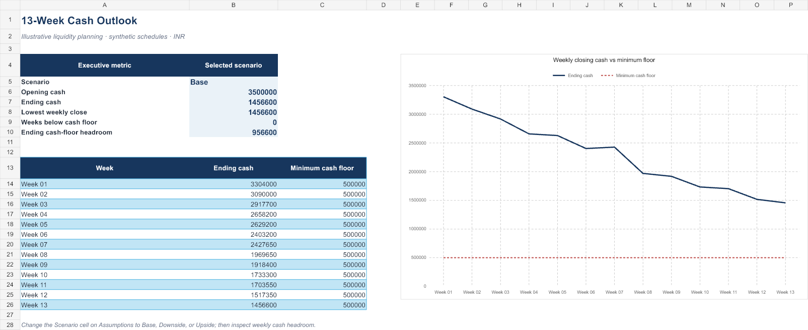

# RITIK Financial Analytics & FP&A Portfolio

An evolving portfolio of self-directed examples in FP&A, financial analytics, Excel modelling, SQL, Python, reporting, and accounting and finance automation.

> All datasets and results are synthetic demonstrations. They are not client work, employment deliverables, or evidence of production deployment. Project pages describe the work and its limits; they do not claim verified professional proficiency.

## Projects

| # | Project | Main tools | What is included |
|---:|---|---|---|
| 1 | [Department FP&A review and forecast](projects/01-fpna-department-review/README.md) | Excel, SQL, Power BI DAX, VBA source | Budget vs actual workbook, illustrative FY2026 forecast, variance queries, DAX starter, and macro source |
| 2 | [Month-end bank reconciliation helper](projects/02-month-end-reconciliation/README.md) | Python | Runnable matching example, synthetic inputs, matched rows, exceptions, and summary |
| 3 | [13-week cash flow forecast](projects/03-thirteen-week-cash-forecast/README.md) | Excel, Python | Scenario-based liquidity workbook, weekly cash bridge, and cash-floor watchlist |
| 4 | [SaaS revenue and retention analytics](projects/04-saas-revenue-retention/README.md) | Python, SQL, Power BI DAX | Customer-month MRR movements, NRR and cohort summaries, measures, and report guide |
| 5 | [Accounts payable controls review](projects/05-ap-controls-review/README.md) | Python, SQL, Power BI DAX | Duplicate and exception review, generated outputs, measures, and report guide |
| 6 | [Capital budgeting and project appraisal](projects/06-capital-budgeting-appraisal/README.md) | Excel, Python | Five-year DCF workbook with NPV, IRR, scenario comparison, and sensitivity grid |
| 7 | [Customer profitability and pricing analytics](projects/07-customer-profitability-pricing/README.md) | Excel, Python, SQL, Power BI DAX | Order-line contribution model, customer and product review, queries, and measures |

## Selected workbook preview

The cash-flow case links AR collection assumptions, AP schedules, operating costs, and weekly cash headroom. The project page includes Base and Downside sample results.

## Portfolio coverage

| Area | Demonstrations in this repository | Status and limits |
|---|---|---|
| Excel | FP&A review, cash forecasting, capital budgeting, and customer profitability workbooks | Synthetic, formula-driven examples |
| Power BI | DAX measures and build guides for FP&A, SaaS, AP, and customer profitability | Native `.pbix` reports are **Coming soon** |
| SQL | Variance, recurring revenue, AP review, and contribution analysis | SQLite-compatible examples |
| Python | Reconciliation, liquidity forecasting, DCF scenarios, cohort analytics, and profitability review | Reproducible synthetic-data demos |
| Financial modelling | Budget forecast, 13-week cash model, and five-year investment appraisal | Illustrative scenarios, not management or investment advice |
| Accounting and finance automation | Bank reconciliation and AP exception review | No ERP integration, journal posting, payment blocking, or approval automation |
| Excel automation | Optional VBA refresh and export module source | Starter module only; not embedded or executed in Excel |

## Data, reproducibility, and next steps

- Every project includes its own inputs, scripts or queries, and run notes where applicable.
- All results are generated from fictional data. They must not be interpreted as company performance or benchmarks.
- Power BI report files remain **Coming soon** until a `.pbix` is built and reviewed.
- Model assumptions are simplified for learning and portfolio demonstration; each project documents what is excluded.
