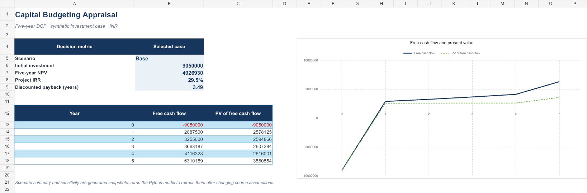

# Capital Budgeting and Project Appraisal

## Purpose

A five-year discounted-cash-flow example for a fictional investment proposal. The model separates operating assumptions, free cash flow, discounting, scenario comparison, and sensitivity so a reviewer can follow how the recommendation metrics are formed.

## Included

- `workbooks/capital_budgeting_appraisal.xlsx` — selected-scenario DCF model, NPV and IRR outputs, three-scenario comparison, and revenue/discount-rate sensitivity.
- `data/scenario_assumptions.csv` — synthetic Base, Downside, and Upside assumptions.
- `scripts/run_appraisal.py` — standard-library scenario and sensitivity calculation.
- `examples/` — generated base cash-flow schedule, scenario summary, and sensitivity grid.
- `model/methodology.md` — cash-flow definitions, tax and working-capital treatment, and model limits.
- `images/appraisal_dashboard.png` — workbook dashboard preview.



## Synthetic scenario snapshot

| Case | Five-year NPV | IRR | Discounted payback |
|---|---:|---:|---:|
| Base | ₹49.27 lakh | 29.5% | 3.49 years |
| Downside | -₹38.75 lakh | -3.4% | Not reached |
| Upside | ₹1.27 crore | 49.3% | 2.40 years |

These values come from the included synthetic assumptions and are examples of model outputs, not a real investment result.

## Run

From this project folder:

```text
python scripts/run_appraisal.py
```

## Interpretation and limits

- All assumptions are synthetic and denominated in INR.
- NPV is unlevered project free cash flow discounted at an illustrative rate; IRR is the rate at which the modelled cash-flow NPV is zero.
- The sensitivity grid is a generated snapshot. Re-run the Python script after editing `scenario_assumptions.csv` to refresh the comparison outputs.
- The workbook is an educational capital-budgeting example, not investment advice, a valuation opinion, or an approved capital request.
