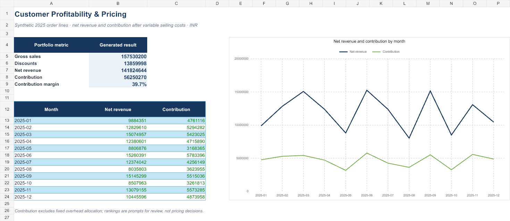

# Customer Profitability and Pricing Analytics

## Purpose

A synthetic order-line case for understanding how discounts, product mix, variable costs, and customer mix affect contribution. The workbook and analytics files separate gross sales from discounts, returns, net revenue, cost of goods, shipping, commission, and contribution.

## Included

- `workbooks/customer_profitability_review.xlsx` — dashboard, product review, customer review, and source transactions.
- `data/sales_lines.csv` — deterministic synthetic 2025 order-line dataset.
- `scripts/generate_synthetic_data.py` and `scripts/build_profitability.py` — reproducible data and summary outputs.
- `examples/` — generated monthly, product, segment, and customer summaries.
- `sql/profitability_analysis.sql` — SQLite-compatible sales and contribution queries.
- `powerbi/measures.dax` and `powerbi/report_build_guide.md` — starter measures and suggested report design.
- `images/customer_profitability_dashboard.png` — workbook dashboard preview.



## Synthetic example output

The generated dataset contains 830 order lines across 60 synthetic customers and six product groups. Its example summary is ₹14,18,24,644 net revenue and ₹5,62,50,270 contribution, or 39.7% contribution margin before fixed overhead allocation. These are generated demonstration values, not business results.

The native Power BI `.pbix` is **Coming soon**. The DAX file and build guide are starter materials, not a completed or published Power BI report.

## Run

From this project folder:

```text
python scripts/generate_synthetic_data.py
python scripts/build_profitability.py
```

## Definitions and limits

- All sales, customer, and product records are synthetic and denominated in INR.
- Contribution is net revenue less product cost, shipping, and sales commission in this demonstration.
- The dataset omits fixed overhead allocation, tax, inventory timing, credit notes beyond the modeled return field, and contractual pricing rules.
- Product and customer rankings are analytical prompts, not pricing or customer decisions.
